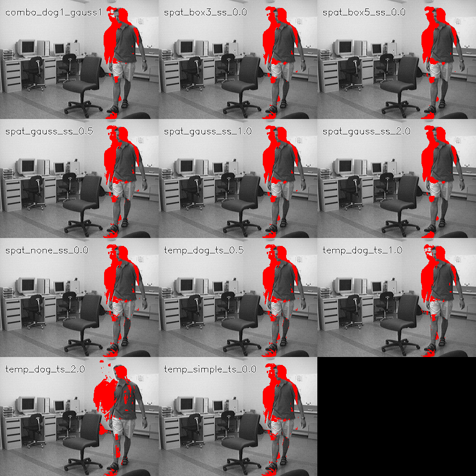

# Motion detection with temporal and spatial filtering

A classical computer-vision course project comparing temporal central differences and derivative-of-Gaussian filters on the fixed-camera RedChair sequence. Spatial box/Gaussian smoothing and a frame-adaptive threshold turn temporal-change magnitudes into motion masks.

**Observed result:** in the inspected sequence, stronger spatial Gaussian smoothing produced cleaner-looking masks than changing the temporal derivative alone. This is a qualitative observation, not a measured segmentation-accuracy improvement.

## What is compared

- Central difference versus temporal derivative-of-Gaussian, sigma 0.5/1/2.
- No spatial smoothing, 3-by-3 and 5-by-5 box filters, and spatial Gaussian sigma 0.5/1/2.
- A combined temporal/spatial Gaussian setting.
- Threshold equal to three times the frame's temporal-magnitude standard deviation.

The masks respond strongly to changing edges and need not fill a whole moving object. Lighting changes, camera motion and weak foreground/background contrast remain limitations. Symmetric temporal filters use future frames, so this is not a causal real-time detector. No annotated ground-truth benchmark is included.

## Code and report

- [Filtering pipeline](project1.py)
- [Comparison-grid helper](make_comparison_grids.py)
- [Original submitted report](project1_report.pdf)

The main script uses Python, NumPy and OpenCV. Place authorized RedChair JPG frames in `RedChair/` beside the script and run `python project1.py`. It writes masks/overlays beneath `cb_EECE_5639_proj_1_out/`. The separate grid helper has its own path configuration. Original dependency versions are not recorded; no new run or image-level performance claim accompanies this README update.

Install dependencies with `python -m pip install -r requirements.txt`. This list is not a lock of the original experiment environment.
